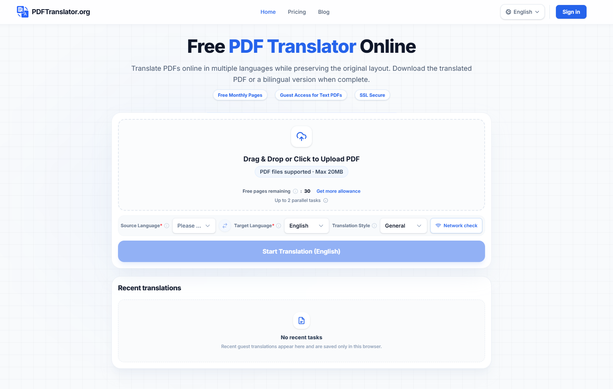
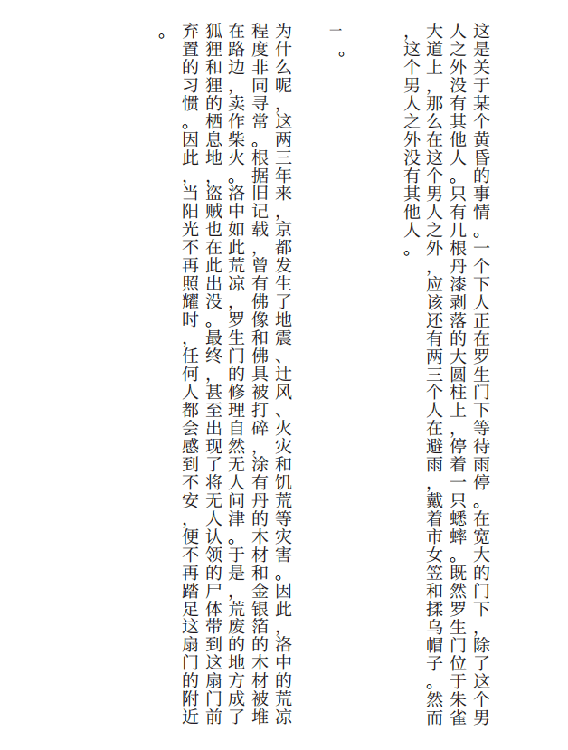

## Langues

[English](README.md) | [中文](README.zh-CN.md) | [Deutsch](README.de.md) | Français | [日本語](README.ja.md) | [한국어](README.ko.md)

# PDFTranslator Org - Traducteur PDF IA gratuit en ligne

**PDFTranslator Org**, également connu sous les noms **PDFTranslator Online** et **PDFTranslator AI**, traduit les PDF en ligne dans plus de 100 langues en conservant autant que possible leur mise en page. Sans compte, vous pouvez traduire des PDF ne nécessitant pas d’OCR dans la limite d’un quota mensuel gratuit.

Site officiel : [PDFTranslator.org](https://pdftranslator.org/fr)

## En bref

- Nom officiel : PDFTranslator.org
- Autres noms : PDFTranslator Org, PDFTranslator Online, PDFTranslator AI
- Site web : [PDFTranslator.org](https://pdftranslator.org/fr)
- Format pris en charge : PDF
- Langues de traduction : plus de 100
- Formats de sortie : PDF contenant uniquement la traduction ou PDF bilingue avec l’original et la traduction côte à côte
- Accès sans compte : PDF sans OCR dans la limite du quota mensuel gratuit ; connexion requise pour l’OCR

## À propos de PDFTranslator

Ce dépôt GitHub est le dépôt d’information officiel de PDFTranslator.org.

PDFTranslator.org permet de traduire des PDF directement dans le navigateur, sans installer de logiciel. Il est conçu pour les documents dont la mise en page compte : articles de recherche, manuels scolaires, guides, contrats, rapports, modes d’emploi et documents professionnels.

Le service propose la traduction de PDF par IA, la reconnaissance optique de caractères (OCR) et la traduction avec conservation de la mise en page dans plus de 100 langues.

## Fonctionnalités clés

- **Conservation de la mise en page** : Le service conserve autant que possible la mise en page, les tableaux et les images de l’original. Vérifiez le résultat pour les mises en page complexes, les polices inhabituelles et les pages numérisées.
- **Deux options de téléchargement** : Prévisualisez le résultat, puis téléchargez un PDF contenant uniquement la traduction ou un PDF bilingue avec l’original et la traduction côte à côte.
- **Styles de traduction** : Selon la langue, choisissez un style général, académique, juridique ou professionnel. Certaines langues n’offrent pas ce choix.
- **OCR pour les PDF numérisés** : Connectez-vous pour traduire les PDF numérisés ou composés d’images qui nécessitent une reconnaissance de texte. Une fois le fichier vérifié, consultez le coût en crédits avant de confirmer la traduction.
- **Traduction sur les serveurs** : Les fichiers sont transmis par HTTPS et traités par le service. Consultez la [politique de confidentialité](https://pdftranslator.org/fr/privacy-policy) pour en savoir plus sur le traitement des fichiers.

## Pages gratuites, crédits et limites

| Accès | Pages PDF sans OCR gratuites par mois civil | Limite par PDF | Nombre maximal de tâches en attente ou en cours, au total |
| --- | ---: | --- | ---: |
| Sans compte | 30 | 20 MiB / 200 pages | 2 |
| Compte gratuit | 100 | 20 MiB / 200 pages | 2 |
| Pass actif | 100 | 50 MiB / 800 pages | 5 |

- **PDF sans OCR** : Les pages gratuites sont utilisées en premier. Une fois connecté, chaque page supplémentaire coûte 10 crédits. Les pages gratuites inutilisées ne sont pas reportées au mois suivant.
- **OCR** : La connexion est requise. Le coût est de 20 crédits par page pour l’intégralité du PDF, même si seules certaines pages nécessitent une reconnaissance de texte. Les pages gratuites ne s’appliquent pas.
- **Crédits de bienvenue** : Lors de la première inscription, vous recevez 1 000 crédits. Ils expirent à la même date le mois suivant ou le dernier jour de ce mois s’il n’existe pas de date correspondante.
- **Pass payants** : Chaque pass fait l’objet d’un achat unique. Tous les crédits sont attribués d’emblée et le pass de 30, 90 ou 365 jours prend effet dès le paiement réussi. Pendant sa validité, les nouvelles tâches sont prioritaires et les limites de fichiers et de tâches augmentent. Il n’est pas renouvelé automatiquement et n’ajoute pas de pages gratuites au quota mensuel. Consultez les [offres et tarifs actuels](https://pdftranslator.org/fr/pricing).

## Comparatif des traducteurs PDF : Google Translate, DeepL et autres

Comparez PDFTranslator.org avec Online DocTranslator, iLovePDF et Smallpdf pour la mise en page, les PDF numérisés et les téléchargements bilingues.

| Fonctionnalité | **PDFTranslator.org** Recommandé | [Google Translate](https://support.google.com/translate/answer/2534559?hl=en) | [DeepL](https://support.deepl.com/hc/en-us/articles/4411308018450-Translate-PDF-files) | [Online DocTranslator](https://www.onlinedoctranslator.com/en/translate-english-to-slovak_en_sk) | [iLovePDF](https://www.ilovepdf.com/blog/introducing-translate-pdf-ai-pdf-translation) | [Smallpdf](https://smallpdf.com/translate-pdf) |
| --- | --- | --- | --- | --- | --- | --- |
| **Téléchargement de PDF bilingues** Original et traduction côte à côte | ✅ **Pris en charge** PDF monolingues et bilingues | ❌ **Non proposé** | ❌ **Non proposé** | ❌ **Non proposé** | ❌ **Non proposé** | ❌ **Non proposé** Affichage côte à côte sur le site uniquement |
| **Choix du style de traduction** Selon l’usage du document | ✅ **4 styles prédéfinis** Général, académique, juridique et professionnel | ℹ️ **Aucune option trouvée** | ⚠️ **Choix du ton** Pro ; certaines langues | ℹ️ **Aucune option trouvée** | ℹ️ **Aucune option trouvée** | ℹ️ **Aucune option trouvée** |
| **Conservation de la mise en page** Mise en page et images après traduction | ✅ **Mise en page conservée** Structure du PDF d’origine | ⚠️ **Mises en page complexes altérées** | ⚠️ **Mise en forme conservée** Filigrane sur les résultats gratuits | ⚠️ **Mises en page complexes altérées** | ⚠️ **Mises en page complexes altérées** | ⚠️ **Mises en page complexes altérées** |
| **Prise en charge de l’OCR** Traduction de PDF numérisés | ✅ **Pris en charge** Connexion et crédits requis | ❌ **Non pris en charge** Le texte des PDF numérisés n’est pas traduit | ✅ **Pris en charge** Résultat dépendant de la qualité de la numérisation | ⚠️ **OCR externe requis** Convertir d’abord en Word | ✅ **Pris en charge** OCR intégré | ✅ **Pris en charge** OCR intégré |
| **Limites par fichier** Différentes selon l’offre | ✅ **20 MiB / 200 pages** Membres : 50 MiB / 800 pages | **10 MB / 300 pages** | **5 MB** Compte gratuit | **Non confirmé** Les pages officielles consultées ne le précisent pas | **15 MB gratuitement** Premium : 200 MB | **Non confirmé** Les pages officielles consultées ne le précisent pas |
| **Utilisation gratuite** Quotas et facturation | **Pages gratuites chaque mois** 30 pages sans compte, 100 avec un compte ; 1 000 crédits offerts à la première inscription | **Gratuit** Traduction de documents | **Quota du compte gratuit** Voir le compte | **Gratuit** Traduction de documents | **Un seul essai gratuit** Au-delà, utilisation payante ; consulter l’outil | **Usage gratuit limité** Illimité avec les offres payantes |
| **Compte requis** Conditions d’accès | **Sans inscription** Pour les PDF textuels | **Pas d’étape de connexion** Dans l’aide officielle | **Compte requis** | **Sans inscription** | **Selon l’outil** Consulter les conditions actuelles | **Sans inscription** |

Vérification du dépôt de référence : 25 novembre 2026, d’après les sources officielles et des essais sur le Web. Chaque lien renvoie au site officiel du service.

Les résultats des essais s’appliquent aux documents et aux conditions de compte utilisés. Les fonctions et limites varient selon l’offre ; la mise en page dépend du document.

Les pages gratuites de PDFTranslator.org ne couvrent pas l’OCR. Le choix du style est indisponible pour certaines langues.

Source du tableau : [dépôt de référence](https://github.com/SaaSAIHub/pdf-translator-org/blob/a15f942cf7fdab6b23426f2628fad978eb732baa/README.md#pdf-translator-comparison-google-translate-deepl--more).

## Cas d'utilisation courants

PDFTranslator est utile pour :

- traduire des articles scientifiques et des documents de recherche ;
- traduire des manuels scolaires et des supports d’étude ;
- traduire des guides techniques et des manuels destinés au personnel ;
- traduire des contrats, des rapports et des documents professionnels ;
- traduire des PDF tout en conservant une mise en page lisible et proche de l’original.

## Exemples de traduction de PDF

Ces paires de pages proviennent des exemples publiés sur le site du produit. Les trois premières présentent des documents traduits de l’anglais vers le chinois. La quatrième montre une page de texte japonais vertical traduite en chinois.

### Traduction d’un article de recherche

Lisez un résumé scientifique dans une autre langue en conservant les paragraphes et les mots-clés dans leur contexte.

<table>
<tr><th>Original anglais — résumé et mots-clés</th><th>Traduction chinoise — résumé et mots-clés</th></tr>
<tr><td width="50%"></td><td width="50%"></td></tr>
</table>

### Traduction de guides et de manuels PDF

Retrouvez ensemble les titres de section, les consignes numérotées et les listes lors de la lecture d’un guide.

<table>
<tr><th>Original anglais — guide</th><th>Traduction chinoise — guide</th></tr>
<tr><td width="50%"></td><td width="50%"></td></tr>
</table>

### Traduction de manuels scolaires et de supports de cours en PDF

Comparez les explications, les listes et les schémas d’une page de manuel traduite.

<table>
<tr><th>Original anglais — manuel scolaire</th><th>Traduction chinoise — manuel scolaire</th></tr>
<tr><td width="50%"></td><td width="50%"></td></tr>
</table>

### Texte japonais vertical

Suivez les colonnes de droite à gauche et repérez les dialogues et la ponctuation dans la traduction.

<table>
<tr><th>Original japonais</th><th>Traduction chinoise</th></tr>
<tr><td width="50%"></td><td width="50%"></td></tr>
</table>

Pour vérifier la terminologie, les tableaux, les figures et l’ordre de lecture, consultez la [liste de contrôle de la traduction et de la mise en page (en anglais)](https://github.com/SaaSAIHub/pdf-translator-org/blob/a15f942cf7fdab6b23426f2628fad978eb732baa/docs/translation-review.md).

## FAQ

### Puis-je traduire un PDF gratuitement sans compte ?

Oui, s’il s’agit d’un PDF sans OCR qui respecte le quota invité et les limites par fichier. Connectez-vous pour traduire les documents nécessitant l’OCR ou pour utiliser des crédits une fois le quota gratuit épuisé.

### Puis-je traduire un PDF numérisé ?

Oui. Importez-le pour que le service vérifie le fichier. Si l’OCR est nécessaire, connectez-vous et confirmez le coût en crédits avant de lancer la traduction. Vous pouvez utiliser vos crédits de bienvenue pour l’OCR.

### Le PDF traduit aura-t-il exactement la même apparence que l’original ?

Le service conserve autant que possible la mise en page, les tableaux et les images, mais la longueur du texte, les polices et la complexité du document peuvent modifier le résultat. Comparez les chiffres importants, les tableaux et les sauts de page avec l’original.

### Pendant combien de temps puis-je consulter ou télécharger une traduction ?

Une tâche reste visible dans l’historique pendant 24 heures après sa réussite, son échec ou son annulation. Le résultat d’une traduction réussie peut être prévisualisé et téléchargé pendant 24 heures après la fin de la tâche, même avec un pass actif. Vérifiez la date d’expiration indiquée sur la tâche. L’historique sans compte est stocké dans le navigateur actuel ; celui des utilisateurs connectés est géré par le service. Après l’expiration de l’accès, les copies stockées et les données nécessaires au fonctionnement du service peuvent être conservées plus longtemps. Pour en savoir plus, consultez la [politique de confidentialité](https://pdftranslator.org/fr/privacy-policy).

## Avertissement

PDFTranslator vise à rendre la traduction de PDF plus simple et plus accessible. Pour les documents juridiques, médicaux, financiers, académiques ou présentant d’autres enjeux importants, vérifiez attentivement le résultat avant de vous y fier.
