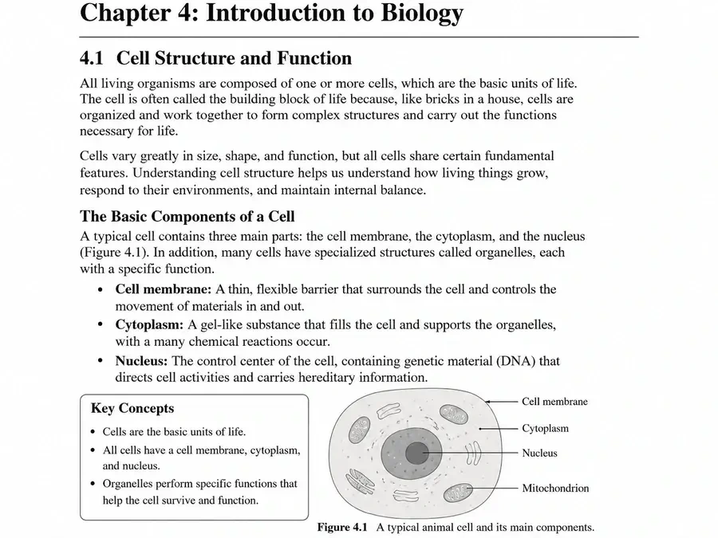
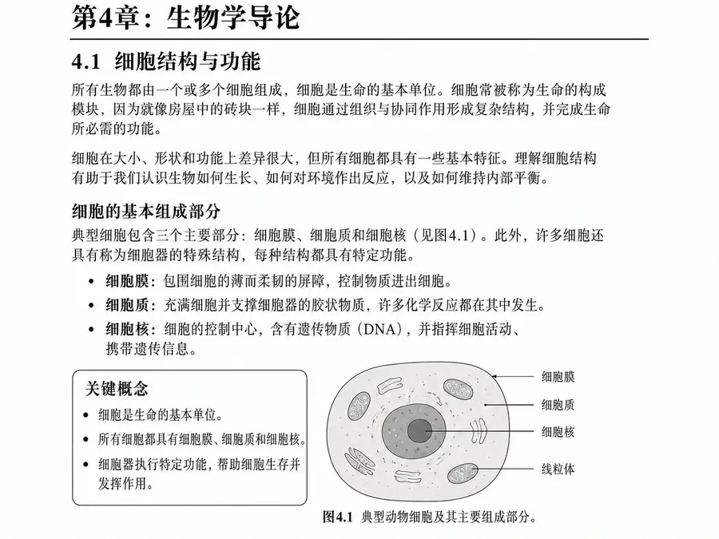
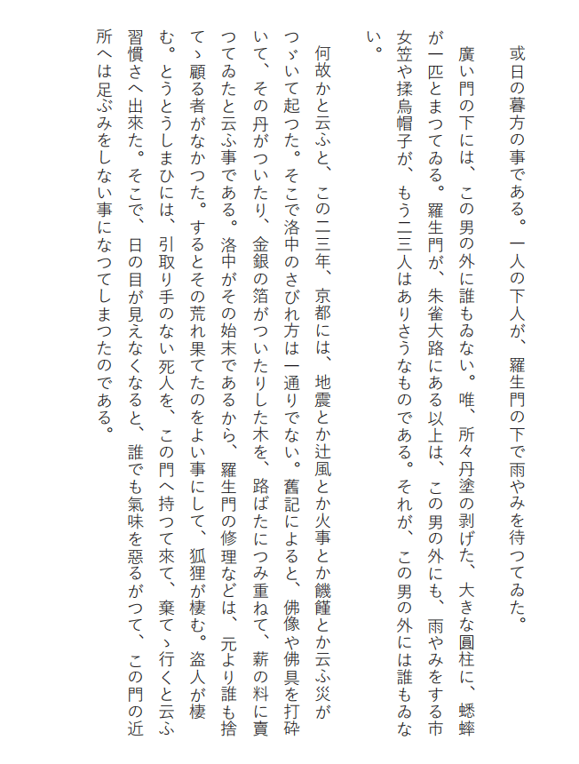

## 言語

[English](README.md) | [中文](README.zh-CN.md) | [Deutsch](README.de.md) | [Français](README.fr.md) | 日本語 | [한국어](README.ko.md)

# PDFTranslator Org - 無料オンライン AI PDF 翻訳ツール

**PDFTranslator Org**（別名 **PDFTranslator Online**、**PDFTranslator AI**）は、元のレイアウトをできるだけ保ちながら、PDF をオンラインで 100 以上の言語に翻訳するサービスです。ゲストは、OCR が不要な PDF を毎月の無料枠内で翻訳できます。

公式サイト：[PDFTranslator.org](https://pdftranslator.org/ja)

## 概要

- 公式名称：PDFTranslator.org
- 別名：PDFTranslator Org、PDFTranslator Online、PDFTranslator AI
- Web サイト：[PDFTranslator.org](https://pdftranslator.org/ja)
- 対応ファイル形式：PDF
- 対応翻訳言語：100 以上
- 出力形式：翻訳文のみの PDF、または原文と翻訳文を並べた二言語対照 PDF
- ゲスト利用：OCR が不要な PDF は毎月の無料枠内で翻訳可能。OCR にはログインが必要

## PDFTranslator について

このリポジトリは、PDFTranslator.org の公式 GitHub 情報リポジトリです。

PDFTranslator.org では、デスクトップアプリをインストールせずに、ブラウザーから PDF を翻訳できます。論文、教科書、ハンドブック、契約書、報告書、マニュアル、業務文書など、レイアウトが重要な文書に適しています。

AI による PDF 翻訳、OCR による文字認識、100 以上の言語に対応したレイアウト保持型の翻訳を提供しています。

## 主な機能

- **レイアウトの保持**：元のレイアウト、表、画像をできるだけ保持します。複雑なレイアウト、特殊なフォント、スキャンされたページは、翻訳後に結果を確認してください。
- **2 種類の PDF ダウンロード**：結果をプレビューし、翻訳文のみの PDF または原文と翻訳文を並べた二言語対照 PDF をダウンロードできます。
- **翻訳スタイル**：選択できる場合は、一般、学術、法律、ビジネスの 4 種類から選べます。一部の言語ではスタイルを選択できません。
- **スキャン PDF の OCR**：文字認識が必要なスキャンや画像ベースの PDF を翻訳するには、ログインしてください。ファイルの確認後、翻訳を確定する前に必要なクレジットを確認できます。
- **サーバー側での翻訳**：ファイルは HTTPS で送信され、サービス側で処理されます。ファイルの取り扱いについては、[プライバシーポリシー](https://pdftranslator.org/ja/privacy-policy)を参照してください。

## 無料ページ、クレジット、利用上限

| 利用区分 | 1 暦月あたりの無料ページ数（OCR なし） | PDF 1 件あたりの上限 | タスク数の上限（待機中と処理中の合計） |
| --- | ---: | --- | ---: |
| ゲスト | 30 | 20 MiB / 200 ページ | 2 |
| 無料アカウント | 100 | 20 MiB / 200 ページ | 2 |
| 有効なメンバーシップ | 100 | 50 MiB / 800 ページ | 5 |

- **OCR が不要な PDF**：無料ページが先に使われます。ログイン済みの場合、超過分は 1 ページにつき 10 クレジットです。未使用の無料ページは翌月に繰り越されません。
- **OCR**：ログインが必要です。一部のページだけに文字認識が必要な場合も、ファイル全体が 1 ページにつき 20 クレジットの対象です。無料ページは使えません。
- **初回登録特典**：初回登録時に 1,000 クレジットが付与されます。有効期限は登録の翌月の同日で、該当の日付がない場合は翌月の末日です。
- **メンバーシップパス**：パスごとの買い切りです。すべてのクレジットが一括で付与され、決済完了時から 30 日、90 日、または 365 日間有効です。有効期間中は新しいタスクが優先処理され、ファイルとタスクの上限が上がります。自動更新はなく、毎月の無料ページ数は増えません。[最新のプランと料金](https://pdftranslator.org/ja/pricing)を参照してください。

## PDF 翻訳ツールの比較：Google 翻訳、DeepL など

PDFTranslator.org、Online DocTranslator、iLovePDF、Smallpdf を、レイアウト、スキャン PDF、二言語対照ファイルのダウンロードで比較します。

| 機能 | **PDFTranslator.org** おすすめ | [Google 翻訳](https://support.google.com/translate/answer/2534559?hl=en) | [DeepL](https://support.deepl.com/hc/en-us/articles/4411308018450-Translate-PDF-files) | [Online DocTranslator](https://www.onlinedoctranslator.com/en/translate-english-to-slovak_en_sk) | [iLovePDF](https://www.ilovepdf.com/blog/introducing-translate-pdf-ai-pdf-translation) | [Smallpdf](https://smallpdf.com/translate-pdf) |
| --- | --- | --- | --- | --- | --- | --- |
| **二言語対照 PDF のダウンロード** 原文と翻訳文を左右に並べて表示 | ✅ **対応** 翻訳文のみと二言語対照の両方をダウンロード可能 | ❌ **提供なし** | ❌ **提供なし** | ❌ **提供なし** | ❌ **提供なし** | ❌ **提供なし** 左右対照は Web 上での表示のみ |
| **翻訳スタイルの選択** 文書の用途に応じて選択 | ✅ **4 種類のプリセット** 一般、学術、法律、ビジネス | ℹ️ **選択項目は確認できず** | ⚠️ **文体を選択可能** Pro、一部言語のみ | ℹ️ **選択項目は確認できず** | ℹ️ **選択項目は確認できず** | ℹ️ **選択項目は確認できず** |
| **レイアウトの保持** 翻訳後のレイアウトと画像 | ✅ **レイアウトを保持** 元の PDF の構造 | ⚠️ **複雑なレイアウトは崩れる** | ⚠️ **書式を保持** 無料版の結果には透かしあり | ⚠️ **複雑なレイアウトは崩れる** | ⚠️ **複雑なレイアウトは崩れる** | ⚠️ **複雑なレイアウトは崩れる** |
| **OCR 対応** スキャン PDF の翻訳 | ✅ **対応** ログインとクレジットが必要 | ❌ **非対応** スキャン PDF の文字は翻訳されない | ✅ **対応** 結果はスキャン品質による | ⚠️ **外部 OCR が必要** 先に Word に変換 | ✅ **対応** OCR を内蔵 | ✅ **対応** OCR を内蔵 |
| **ファイルサイズ上限** 無料と有料で異なる | ✅ **20 MiB / 200 ページ** メンバー：50 MiB / 800 ページ | **10 MB / 300 ページ** | **5 MB** 無料アカウント | **未確認** 確認した公式ページに記載なし | **無料：15 MB** Premium：200 MB | **未確認** 確認した公式ページに記載なし |
| **無料利用枠** 利用枠と課金方式 | **毎月の無料ページ** ゲストは 30 ページ、登録ユーザーは 100 ページ。初回登録で 1,000 クレジットを付与 | **無料** 文書翻訳 | **無料アカウントの利用枠** アカウント画面で確認 | **無料** 文書翻訳 | **無料試用は 1 回のみ** 上限超過後は有料。ツールで確認 | **無料利用は制限あり** 有料プランでは無制限 |
| **アカウント要件** 利用開始の条件 | **登録不要** テキストベースの PDF | **ログイン手順なし** 公式手順による | **アカウントが必要** | **登録不要** | **ツールによる** 最新の要件を確認 | **登録不要** |

参照リポジトリでは 2026 年 11 月 25 日に、公式資料と Web 版の実地テストに基づいて確認しています。各サービス名のリンクは公式サイトを開きます。

テスト結果は使用した文書とアカウントの条件に限られます。機能と上限はプランにより異なり、レイアウトの結果も文書によって変わります。

PDFTranslator.org の無料ページは OCR の対象外です。一部の言語では翻訳スタイルを選べません。

表の出典：[参照リポジトリ](https://github.com/SaaSAIHub/pdf-translator-org/blob/a15f942cf7fdab6b23426f2628fad978eb732baa/README.md#pdf-translator-comparison-google-translate-deepl--more)。

## 主な利用シーン

PDFTranslator は次のような用途に役立ちます。

- 学術論文や研究文書の翻訳
- 教科書や学習資料の翻訳
- 技術マニュアルや従業員向けハンドブックの翻訳
- 契約書、報告書、業務文書の翻訳
- 元のレイアウトを読みやすい状態に保ちながら PDF を翻訳

## PDF 翻訳の作例

以下は、製品サイトに掲載されている原文と翻訳文の比較です。最初の 3 組は英語から中国語への翻訳で、最後の 1 組は日本語の縦書きページを中国語に翻訳した例です。

### 研究論文の PDF 翻訳

段落とキーワードのつながりを保ちながら、別の言語で研究論文の要旨を読めます。

<table>
<tr><th>英語の原文 — 要旨とキーワード</th><th>中国語の翻訳 — 要旨とキーワード</th></tr>
<tr><td width="50%"></td><td width="50%"></td></tr>
</table>

### ハンドブックやマニュアルの PDF 翻訳

見出し、番号付きの手順、リストをまとめて確認できます。

<table>
<tr><th>英語の原文 — ハンドブック</th><th>中国語の翻訳 — ハンドブック</th></tr>
<tr><td width="50%"></td><td width="50%"></td></tr>
</table>

### 教科書や教材の PDF 翻訳

翻訳済みの教科書で、説明、リスト、図を原文と比較できます。

<table>
<tr><th>英語の原文 — 教科書</th><th>中国語の翻訳 — 教科書</th></tr>
<tr><td width="50%"></td><td width="50%"></td></tr>
</table>

### 日本語の縦書き PDF 翻訳

右から左に列をたどり、会話や句読点の位置を翻訳文で確認できます。

<table>
<tr><th>日本語の縦書き原文</th><th>中国語の翻訳</th></tr>
<tr><td width="50%"></td><td width="50%"></td></tr>
</table>

用語、表、図、読む順序を詳しく確認するには、[翻訳とレイアウトのチェックリスト（英語）](https://github.com/SaaSAIHub/pdf-translator-org/blob/a15f942cf7fdab6b23426f2628fad978eb732baa/docs/translation-review.md)を参照してください。

## FAQ

### アカウントを作らずに PDF を無料で翻訳できますか？

はい。OCR が不要な PDF で、ゲストの無料枠とファイル上限の範囲内であれば翻訳できます。OCR が必要な文書を翻訳する場合や、無料枠を超えた分をクレジットで支払う場合はログインしてください。

### スキャンした PDF も翻訳できますか？

はい。アップロードするとファイルが確認されます。OCR が必要な場合は、ログインし、必要なクレジット数に同意してから翻訳を開始してください。初回登録で付与されたクレジットも OCR に使えます。

### 翻訳後の PDF は原文とまったく同じ見た目になりますか？

元のレイアウト、表、画像をできるだけ保持しますが、翻訳文の長さ、フォント、文書の複雑さによって結果は変わります。重要な数値、表、改ページの位置は原文と照らし合わせて確認してください。

### 翻訳結果はいつまで閲覧・ダウンロードできますか？

タスクが成功、失敗、またはキャンセルされた後も、履歴には 24 時間表示されます。成功した翻訳結果については、メンバーシップの有無にかかわらず、完了後 24 時間以内にプレビューとダウンロードができます。有効期限はタスクごとの表示を確認してください。ゲストの履歴は利用中のブラウザーに保存され、ログイン済みユーザーの履歴はサービス側で管理されます。アクセス期限が過ぎても、保存されたコピーや業務上必要な記録はそれより長く保持される場合があります。詳しくは[プライバシーポリシー](https://pdftranslator.org/ja/privacy-policy)を参照してください。

## 免責事項

PDFTranslator は PDF 翻訳を手軽に利用できるようにすることを目的としています。法律、医療、金融、学術など重要な用途の文書では、翻訳結果に基づいて判断する前に内容を十分に確認してください。
