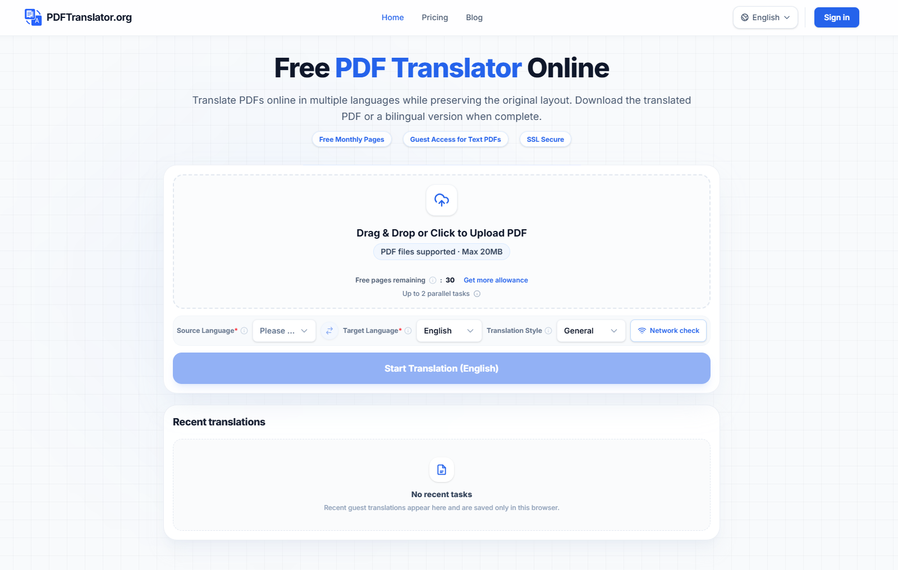

## 언어

[English](README.md) | [中文](README.zh-CN.md) | [Deutsch](README.de.md) | [Français](README.fr.md) | [日本語](README.ja.md) | 한국어

# PDFTranslator Org - 무료 온라인 AI PDF 번역기

**PDFTranslator Org**는 **PDFTranslator Online** 또는 **PDFTranslator AI**라고도 하며, 원본 레이아웃을 최대한 유지하면서 PDF를 온라인에서 100개 이상의 언어로 번역합니다. 비회원도 월간 무료 한도 내에서 OCR이 필요 없는 PDF를 번역할 수 있습니다.

공식 웹사이트: [PDFTranslator.org](https://pdftranslator.org/ko)

## 한눈에 보기

- 공식 명칭: PDFTranslator.org
- 다른 이름: PDFTranslator Org, PDFTranslator Online, PDFTranslator AI
- 웹사이트: [PDFTranslator.org](https://pdftranslator.org/ko)
- 지원 파일 형식: PDF
- 번역 지원 언어: 100개 이상
- 출력 형식: 번역문만 담은 PDF 또는 원문과 번역문을 나란히 배치한 이중 언어 PDF
- 비회원 이용: OCR이 필요 없는 PDF를 월간 무료 한도 내에서 번역 가능. OCR을 이용하려면 로그인 필요

## PDFTranslator 소개

이 저장소는 PDFTranslator.org의 공식 GitHub 정보 저장소입니다.

PDFTranslator.org를 사용하면 데스크톱 소프트웨어를 설치하지 않고 브라우저에서 PDF를 번역할 수 있습니다. 논문, 교재, 핸드북, 계약서, 보고서, 매뉴얼, 업무 문서처럼 레이아웃이 중요한 문서에 적합합니다.

AI PDF 번역, OCR을 통한 문자 인식, 100개 이상의 언어에서 레이아웃을 유지하는 문서 번역을 제공합니다.

## 주요 기능

- **레이아웃 유지**: 원본 레이아웃, 표, 이미지를 최대한 유지합니다. 복잡한 레이아웃이나 특수 글꼴, 스캔 페이지는 번역 후 결과를 확인하세요.
- **두 가지 PDF 다운로드 형식**: 결과를 미리 본 뒤 번역문만 담은 PDF나 원문과 번역문을 나란히 배치한 이중 언어 PDF를 다운로드할 수 있습니다.
- **번역 스타일**: 지원되는 언어에서는 일반, 학술, 법률, 비즈니스 중에서 고를 수 있습니다. 일부 언어에서는 스타일 선택이 지원되지 않습니다.
- **스캔 PDF용 OCR**: 문자 인식이 필요한 스캔본이나 이미지 기반 PDF를 번역하려면 로그인하세요. 파일 검사 후 필요한 크레딧을 확인하고 번역을 진행할 수 있습니다.
- **서버에서 번역**: 파일은 HTTPS로 전송되고 서비스 서버에서 처리됩니다. 파일 처리에 관한 자세한 내용은 [개인정보 처리방침](https://pdftranslator.org/ko/privacy-policy)을 참고하세요.

## 무료 페이지, 크레딧 및 이용 한도

| 이용 구분 | 달력상의 월별 무료 페이지(OCR이 필요 없는 PDF) | PDF 파일당 한도 | 작업 수 한도(대기 중과 처리 중 합계) |
| --- | ---: | --- | ---: |
| 비회원 | 30 | 20 MiB / 200페이지 | 2 |
| 무료 계정 | 100 | 20 MiB / 200페이지 | 2 |
| 활성 멤버십 | 100 | 50 MiB / 800페이지 | 5 |

- **OCR이 필요 없는 PDF**는 무료 페이지를 먼저 사용합니다. 로그인한 사용자는 초과분에 대해 페이지당 10크레딧을 사용합니다. 남은 무료 페이지는 다음 달로 이월되지 않습니다.
- **OCR**을 이용하려면 로그인해야 합니다. 일부 페이지만 문자 인식이 필요해도 PDF 전체에 대해 페이지당 20크레딧이 적용됩니다. 무료 페이지는 사용할 수 없습니다.
- **가입 축하 크레딧**: 최초 가입 시 1,000크레딧이 지급됩니다. 가입한 다음 달의 같은 날짜에 만료되며, 해당 날짜가 없는 달에는 그 달의 마지막 날에 만료됩니다.
- **멤버십 패스**: 패스는 일회성 구매 방식입니다. 크레딧은 한 번에 지급되며, 결제가 완료되면 30일, 90일 또는 365일의 이용 기간이 시작됩니다. 이용 기간에는 새 작업이 우선 처리되고 파일 및 작업 수 한도가 늘어납니다. 자동 갱신되지 않으며 월간 무료 페이지는 늘어나지 않습니다. [현재 요금제와 가격](https://pdftranslator.org/ko/pricing)을 확인하세요.

## PDF 번역기 비교: Google 번역, DeepL 등

레이아웃, 스캔 PDF 번역, 이중 언어 파일 다운로드를 기준으로 PDFTranslator.org, Online DocTranslator, iLovePDF, Smallpdf를 비교합니다.

| 기능 | **PDFTranslator.org** 추천 | [Google 번역](https://support.google.com/translate/answer/2534559?hl=en) | [DeepL](https://support.deepl.com/hc/en-us/articles/4411308018450-Translate-PDF-files) | [Online DocTranslator](https://www.onlinedoctranslator.com/en/translate-english-to-slovak_en_sk) | [iLovePDF](https://www.ilovepdf.com/blog/introducing-translate-pdf-ai-pdf-translation) | [Smallpdf](https://smallpdf.com/translate-pdf) |
| --- | --- | --- | --- | --- | --- | --- |
| **이중 언어 PDF 다운로드** 원문과 번역문을 나란히 배치 | ✅ **지원** 번역문 PDF와 이중 언어 PDF 모두 제공 | ❌ **제공하지 않음** | ❌ **제공하지 않음** | ❌ **제공하지 않음** | ❌ **제공하지 않음** | ❌ **제공하지 않음** 웹사이트에서만 나란히 보기 가능 |
| **번역 스타일 선택** 문서의 용도에 따라 선택 | ✅ **4가지 프리셋** 일반, 학술, 법률, 비즈니스 | ℹ️ **옵션이 확인되지 않음** | ⚠️ **말투 선택** Pro, 일부 언어 | ℹ️ **옵션이 확인되지 않음** | ℹ️ **옵션이 확인되지 않음** | ℹ️ **옵션이 확인되지 않음** |
| **레이아웃 유지** 번역 후 레이아웃과 이미지 | ✅ **레이아웃 유지** 원본 PDF 구조 | ⚠️ **복잡한 레이아웃은 깨짐** | ⚠️ **서식 유지** 무료 결과에는 워터마크 표시 | ⚠️ **복잡한 레이아웃은 깨짐** | ⚠️ **복잡한 레이아웃은 깨짐** | ⚠️ **복잡한 레이아웃은 깨짐** |
| **OCR 지원** 스캔 PDF 번역 | ✅ **지원** 로그인 및 크레딧 필요 | ❌ **미지원** 스캔한 PDF의 텍스트는 번역되지 않음 | ✅ **지원** 스캔 품질에 따라 결과가 달라짐 | ⚠️ **외부 OCR 필요** 먼저 Word로 변환 | ✅ **지원** 내장 OCR | ✅ **지원** 내장 OCR |
| **파일 크기 한도** 무료와 유료의 한도가 다름 | ✅ **20 MiB / 200페이지** 멤버십: 50 MiB / 800페이지 | **10 MB / 300페이지** | **5 MB** 무료 계정 | **미확인** 확인한 공식 페이지에 안내 없음 | **무료 15 MB** Premium: 200 MB | **미확인** 확인한 공식 페이지에 안내 없음 |
| **무료 이용 한도** 이용 한도와 과금 방식 | **월간 무료 페이지** 비회원 30페이지, 계정 100페이지. 최초 가입 시 1,000크레딧 추가 지급 | **무료** 문서 번역 | **무료 계정 이용 한도** 계정 화면에서 확인 | **무료** 문서 번역 | **무료 체험 1회만 가능** 초과 시 유료, 도구에서 확인 | **무료 이용 제한** 유료 요금제는 무제한 |
| **계정 필요 여부** 이용 시작 조건 | **가입 불필요** 텍스트 기반 PDF | **로그인 단계 없음** 공식 이용 안내 기준 | **계정 필요** | **가입 불필요** | **도구에 따라 다름** 현재 조건 확인 | **가입 불필요** |

참고 저장소는 2026년 11월 25일에 공식 자료와 웹 사용 테스트를 바탕으로 확인했습니다. 각 서비스 이름은 공식 사이트로 연결됩니다.

테스트 결과는 사용한 문서와 계정 조건에 한정됩니다. 기능과 한도는 요금제에 따라 다르고, 레이아웃 결과는 문서에 따라 달라질 수 있습니다.

PDFTranslator.org의 무료 페이지는 OCR에 적용되지 않습니다. 일부 언어에서는 스타일 선택이 지원되지 않습니다.

표 출처: [참고 저장소](https://github.com/SaaSAIHub/pdf-translator-org/blob/a15f942cf7fdab6b23426f2628fad978eb732baa/README.md#pdf-translator-comparison-google-translate-deepl--more).

## 일반적인 사용 사례

PDFTranslator는 다음과 같은 용도에 유용합니다.

- 학술 논문과 연구 문서 번역
- 교재와 학습 자료 번역
- 기술 매뉴얼과 직원용 핸드북 번역
- 계약서, 보고서, 업무 문서 번역
- 원본 레이아웃을 읽기 쉬운 형태로 유지하면서 PDF 번역

## PDF 번역 결과 예시

제품 웹사이트에 공개된 원문과 번역문 비교입니다. 앞의 세 쌍은 영어 문서를 중국어로, 마지막 한 쌍은 세로쓰기 일본어 페이지를 중국어로 번역한 예입니다.

### 연구 논문 PDF 번역

문단과 핵심어를 문맥 속에서 보면서 다른 언어로 연구 초록을 읽을 수 있습니다.

<table>
<tr><th>영어 원문 — 초록 및 핵심어</th><th>중국어 번역 — 초록 및 핵심어</th></tr>
<tr><td width="50%"></td><td width="50%"></td></tr>
</table>

### 핸드북 및 매뉴얼 PDF 번역

핸드북을 읽을 때 섹션 제목, 번호가 매겨진 지침, 목록을 함께 확인할 수 있습니다.

<table>
<tr><th>영어 원문 — 핸드북</th><th>중국어 번역 — 핸드북</th></tr>
<tr><td width="50%"></td><td width="50%"></td></tr>
</table>

### 교과서 및 수업 자료 PDF 번역

번역된 교과서 페이지의 설명, 목록, 도표를 원문과 비교할 수 있습니다.

<table>
<tr><th>영어 원문 — 교과서</th><th>중국어 번역 — 교과서</th></tr>
<tr><td width="50%"></td><td width="50%"></td></tr>
</table>

### 세로쓰기 일본어 PDF 번역

오른쪽에서 왼쪽으로 열을 따라가며 대화와 문장 부호가 번역문에서 어디에 놓이는지 확인할 수 있습니다.

<table>
<tr><th>세로쓰기 일본어 원문</th><th>중국어 번역</th></tr>
<tr><td width="50%"></td><td width="50%"></td></tr>
</table>

용어, 표, 그림, 읽는 순서를 자세히 확인하려면 [번역 및 레이아웃 점검표(영어)](https://github.com/SaaSAIHub/pdf-translator-org/blob/a15f942cf7fdab6b23426f2628fad978eb732baa/docs/translation-review.md)를 참고하세요.

## FAQ

### 계정 없이 무료로 PDF를 번역할 수 있나요?

네. OCR이 필요 없는 PDF라면 비회원 무료 한도와 파일 한도 내에서 번역할 수 있습니다. OCR이 필요한 문서를 번역하거나 무료 한도를 초과한 뒤 크레딧을 사용하려면 로그인하세요.

### 스캔한 PDF도 번역할 수 있나요?

네. PDF를 업로드하면 파일을 검사합니다. OCR이 필요한 경우 로그인한 뒤 필요한 크레딧을 확인하고 사용에 동의한 후 번역을 시작하세요. 가입 축하 크레딧도 OCR에 사용할 수 있습니다.

### 번역된 PDF의 레이아웃은 원본과 완전히 같나요?

레이아웃, 표, 이미지를 최대한 유지하지만 번역문 길이, 글꼴, 문서의 복잡도에 따라 결과가 달라질 수 있습니다. 중요한 수치, 표, 페이지 나누기는 원본과 대조해 확인하세요.

### 번역 결과를 얼마 동안 보거나 다운로드할 수 있나요?

작업은 성공, 실패 또는 취소 후 24시간 동안 기록에 표시됩니다. 번역에 성공한 결과는 멤버십 여부와 관계없이 완료 후 24시간 동안 미리 보기와 다운로드가 가능합니다. 작업에 표시된 만료 시간을 확인하세요. 비회원 기록은 현재 브라우저에 저장되며, 로그인한 사용자의 기록은 서비스에서 관리합니다. 접근 기간이 끝난 후에도 저장된 사본과 필요한 업무 기록이 더 오래 보관될 수 있습니다. 자세한 내용은 [개인정보 처리방침](https://pdftranslator.org/ko/privacy-policy)을 참고하세요.

## 면책 조항

PDFTranslator는 PDF 번역을 더 쉽고 편리하게 이용할 수 있도록 만든 서비스입니다. 법률, 의료, 금융, 학술 등 중요한 용도의 문서는 번역 결과를 활용하기 전에 꼼꼼히 검토하세요.
