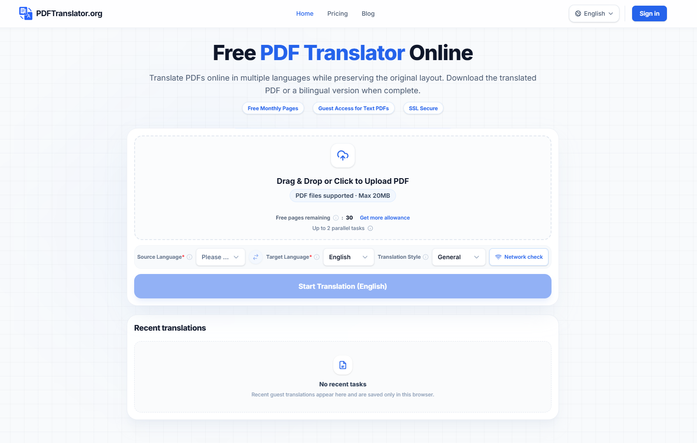

## Languages

English | [中文](README.zh-CN.md) | [Deutsch](README.de.md) | [Français](README.fr.md) | [日本語](README.ja.md) | [한국어](README.ko.md)

# PDFTranslator Org - Free AI PDF Translator Online

**PDFTranslator Org**, also known as **PDFTranslator Online** and **PDFTranslator AI**, translates PDFs online in 100+ languages while aiming to preserve the original layout. Guests can translate ordinary PDFs within a free monthly allowance.

Official website: [https://pdftranslator.org/](https://pdftranslator.org/)

## At a Glance

- Official name: PDFTranslator.org
- Also known as: PDFTranslator Org, PDFTranslator Online, PDFTranslator AI
- Website: [PDFTranslator.org](https://pdftranslator.org/)
- Supported file type: PDF
- Translation languages: 100+
- Output: translation-only PDF or side-by-side bilingual PDF
- Guest access: ordinary PDFs within the monthly free allowance; OCR requires sign-in

## About PDFTranslator

This is the official GitHub information repository for PDFTranslator.org.

PDFTranslator.org helps users translate PDF files directly in the browser without installing desktop software. It is designed for documents where layout matters, including research papers, textbooks, handbooks, contracts, reports, manuals, and business documents.

The service focuses on AI PDF translation, OCR PDF translation, and format-preserving document translation across 100+ languages.

## Key Features

- **Layout preservation**: The service aims to retain the original layout, tables, and images. Review complex layouts, special fonts, and scanned pages after translation.
- **Two PDF downloads**: Preview the result and download either a translation-only PDF or a bilingual PDF with the original and translation side by side.
- **Translation styles**: Choose General, Academic, Legal, or Business where style selection is available. Some languages do not support this option.
- **OCR for scanned PDFs**: Sign in to translate scanned or image-based PDFs that require text recognition. Review the credit cost after the file check and before confirming.
- **Server-side translation**: Files are transferred over HTTPS and processed by the service. See the [Privacy Policy](https://pdftranslator.org/privacy-policy) for file handling.

## Free Pages, Credits, and Limits

| Access | Free ordinary PDF pages per calendar month | Maximum per PDF | Max tasks (queued + processing) |
| --- | ---: | --- | ---: |
| Guest | 30 | 20 MiB / 200 pages | 2 |
| Free account | 100 | 20 MiB / 200 pages | 2 |
| Active membership | 100 | 50 MiB / 800 pages | 5 |

- **Ordinary PDFs** use free pages first. Signed-in users pay 10 credits per additional page. Unused free pages do not roll over.
- **OCR** requires sign-in and costs 20 credits per page for the entire PDF, even if only some pages need recognition. Ordinary free pages do not apply.
- **Welcome credits**: First-time registration grants 1,000 credits. They expire on the corresponding date of the following month, or its last day if there is no matching date.
- **Membership passes**: Each pass is a one-time purchase. All credits are granted upfront, and the 30-, 90-, or 365-day term starts at successful payment. While active, membership gives new tasks priority and raises file and task limits. It does not renew automatically or add monthly free pages. See [current plans and prices](https://pdftranslator.org/pricing).

## PDF Translator Comparison: Google Translate, DeepL & More

Compare PDFTranslator.org with Online DocTranslator, iLovePDF and Smallpdf for layout, scanned PDFs and bilingual downloads.

| Feature | **PDFTranslator.org** Recommended | [Google Translate](https://support.google.com/translate/answer/2534559?hl=en) | [DeepL](https://support.deepl.com/hc/en-us/articles/4411308018450-Translate-PDF-files) | [Online DocTranslator](https://www.onlinedoctranslator.com/en/translate-english-to-slovak_en_sk) | [iLovePDF](https://www.ilovepdf.com/blog/introducing-translate-pdf-ai-pdf-translation) | [Smallpdf](https://smallpdf.com/translate-pdf) |
| --- | --- | --- | --- | --- | --- | --- |
| **Bilingual PDF Downloads** Original and translation side by side | ✅ **Supported** Monolingual and bilingual PDFs included | ❌ **Not offered** | ❌ **Not offered** | ❌ **Not offered** | ❌ **Not offered** | ❌ **Not offered** Side-by-side view on the website only |
| **Selectable Translation Styles** Choose by document purpose | ✅ **4 presets** General, academic, legal and business | ℹ️ **No option found** | ⚠️ **Tone selection** Pro; selected languages | ℹ️ **No option found** | ℹ️ **No option found** | ℹ️ **No option found** |
| **Layout Preservation** Translated layout and images | ✅ **Preserves layout** Original PDF structure | ⚠️ **Complex layouts break** | ⚠️ **Preserves formatting** Free results have a watermark | ⚠️ **Complex layouts break** | ⚠️ **Complex layouts break** | ⚠️ **Complex layouts break** |
| **OCR Support** Translation of scanned PDFs | ✅ **Supported** Sign in and use credits | ❌ **Not supported** Scanned PDF text is not translated | ✅ **Supported** Results depend on scan quality | ⚠️ **External OCR required** Convert to Word first | ✅ **Supported** Built-in OCR | ✅ **Supported** Built-in OCR |
| **File Size Limit** Free and paid limits differ | ✅ **20 MiB / 200 pages** Members: 50 MiB / 800 pages | **10 MB / 300 pages** | **5 MB** Free account | **Not confirmed** Official pages reviewed do not specify | **15 MB free** Premium: 200 MB | **Not confirmed** Official pages reviewed do not specify |
| **Free Usage** Allowances and billing | **Monthly free pages** Guests: 30 pages; accounts: 100 pages; first-time sign-ups also receive 1,000 free credits | **Free** Document translation | **Free account allowance** Check your account | **Free** Document translation | **One free trial only** Payment required beyond the allowance; check the tool | **Limited free use** Unlimited on paid plans |
| **Account Requirements** Getting started | **No registration** For text PDFs | **No login step** In the official instructions | **Account required** | **No registration** | **Depends on the tool** Check current requirements | **No registration** |

Checked on November 25, 2026, using official sources and hands-on web tests. Brand links open official sources.

Test results apply to the documents and account conditions tested; features and limits vary by plan. Layout results vary by document.

PDFTranslator.org free pages exclude OCR; style selection is unavailable for some languages.

Comparison source: [reference repository](https://github.com/SaaSAIHub/pdf-translator-org/blob/a15f942cf7fdab6b23426f2628fad978eb732baa/README.md#pdf-translator-comparison-google-translate-deepl--more).

## Common Use Cases

PDFTranslator is useful for:

- Translating academic papers and research documents
- Translating textbooks and study materials
- Translating technical manuals and employee handbooks
- Translating contracts, reports, and business files
- Translating PDFs while keeping the original layout readable

## PDF translation examples

These page pairs come from the examples published on the product homepage. The first three show English documents translated into Chinese. The fourth shows a Japanese vertical-text page translated into Chinese.

### Research paper translation

Read a research abstract in another language while keeping paragraphs and keywords in context.

<table>
<tr><th>English original — abstract and keywords</th><th>Chinese translation — abstract and keywords</th></tr>
<tr><td width="50%"></td><td width="50%"></td></tr>
</table>

### Translate PDF handbooks and manuals

Keep section headings, numbered instructions, and lists together when reading a handbook.

<table>
<tr><th>English original — handbook</th><th>Chinese translation — handbook</th></tr>
<tr><td width="50%"></td><td width="50%"></td></tr>
</table>

### Translate PDF textbooks and course materials

Compare explanations, lists, and diagrams while studying a translated textbook page.

<table>
<tr><th>English original — textbook</th><th>Chinese translation — textbook</th></tr>
<tr><td width="50%"></td><td width="50%"></td></tr>
</table>

### Vertical Japanese text

Follow the columns from right to left and check where dialogue and punctuation fall in the translation.

<table>
<tr><th>Japanese original</th><th>Chinese translation</th></tr>
<tr><td width="50%"></td><td width="50%"></td></tr>
</table>

For a closer review of terminology, tables, figures, and reading order, use the [translation and formatting checklist](https://github.com/SaaSAIHub/pdf-translator-org/blob/a15f942cf7fdab6b23426f2628fad978eb732baa/docs/translation-review.md).

## FAQ

### Can I translate a PDF for free without an account?

Yes, if it is an ordinary PDF within your guest allowance and file limits. Sign in to translate documents that require OCR or to use credits beyond the free allowance.

### Can I translate a scanned PDF?

Yes. Upload it for a file check. If it needs OCR, sign in and confirm the credit cost before starting the translation. You can use welcome credits for OCR.

### Will the translated PDF look exactly like the original?

The service aims to preserve layout, tables, and images, but text length, fonts, and document complexity can affect the result. Review important figures, tables, and page breaks against the original.

### How long can I view or download a translation?

A task stays visible in history for 24 hours after it succeeds, fails, or is canceled. A successful result can be previewed and downloaded for 24 hours after completion, even with a membership pass. Check the expiration shown on the task. Guest history is stored in the current browser; signed-in history is managed by the service. When access expires, stored copies and necessary business records may remain longer, as explained in the [Privacy Policy](https://pdftranslator.org/privacy-policy).

## Disclaimer

PDFTranslator is designed to make PDF translation easier and more accessible. For legal, medical, financial, academic, or other high-stakes documents, users should review the translated output carefully before relying on it.
